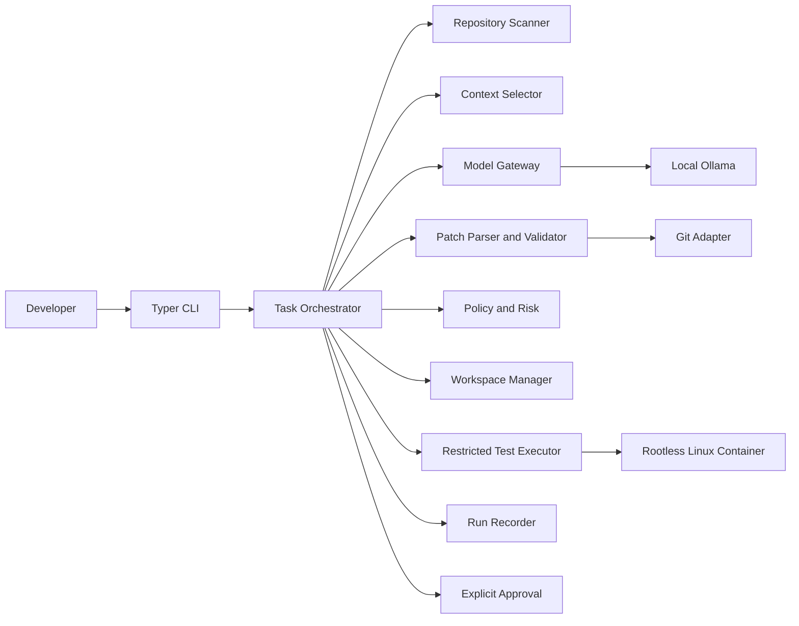
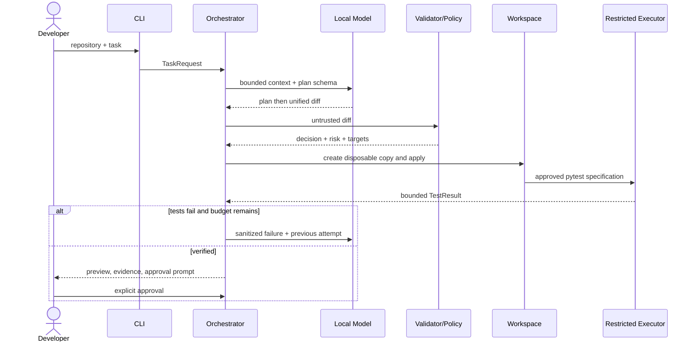
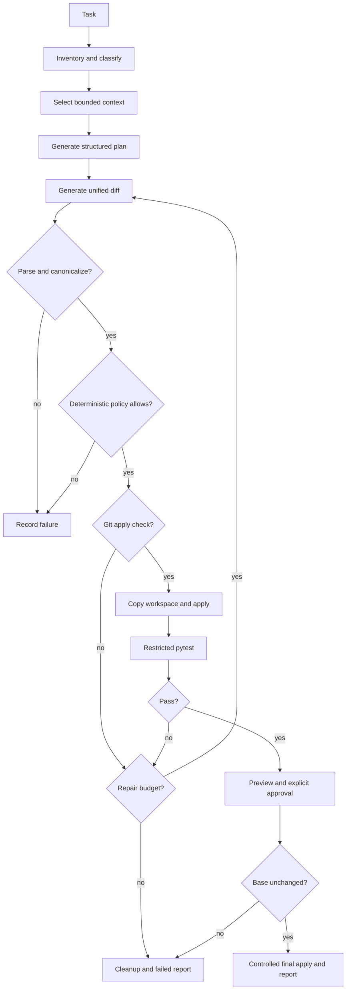
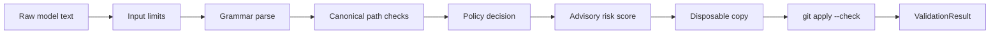
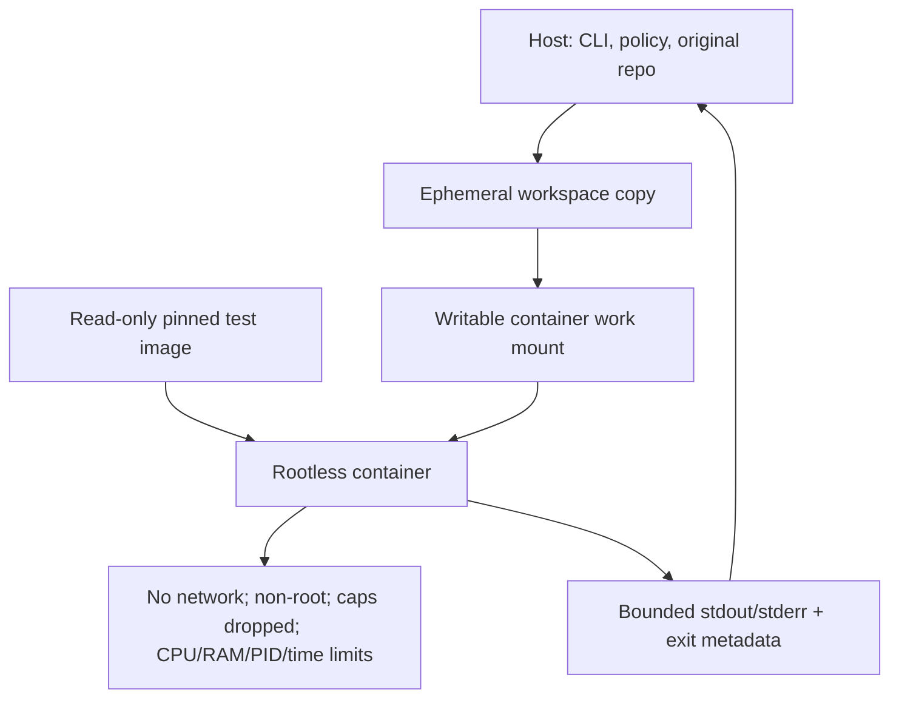
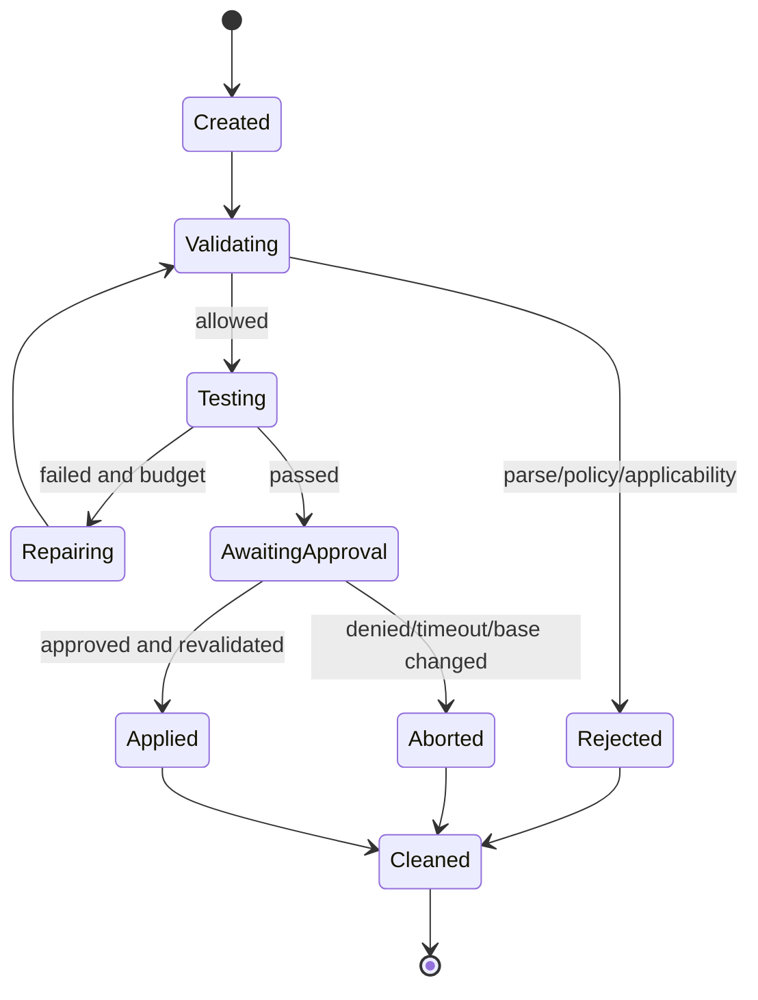
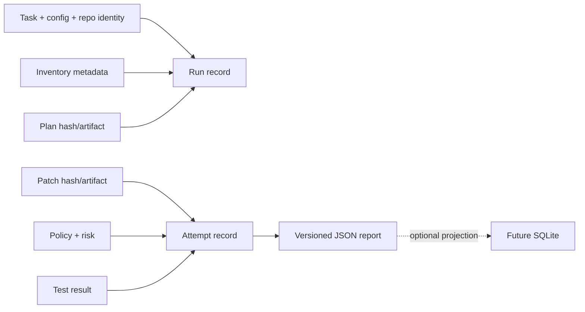

# System Architecture

## Architectural Style

LACE is a modular monolith. The CLI calls an application orchestrator; domain services operate on typed contracts; adapters isolate Git, Ollama, filesystem, container runtime, clock, and persistence. Dependency flow points inward to contracts and policy. The model has no direct tool authority.

## Components and Interfaces

| Component | Responsibility | Principal interface | Dependencies |
|---|---|---|---|
| `cli` | Parse commands, render output, map exit codes | `main()`, `doctor`, later `run` | application services |
| `config` | Load defaults/file/env and validate | `Settings` | Pydantic |
| `contracts` | Versioned immutable request/result records | models/enums | none |
| `repository` | Identify root, inventory metadata, state hashes | `RepositoryGateway` | filesystem/Git |
| `context` | Score and budget prompt context | `ContextSelector` | inventory |
| `model` | Local inference and response normalization | `ModelGateway` | Ollama HTTP |
| `patches` | Parse diff and derive canonical targets/stats | `parse_unified_diff` | pure domain logic |
| `policy` | Deterministic allow/deny and advisory risk | `evaluate_patch` | contracts/config |
| `workspace` | Disposable copies, integrity, cleanup | `WorkspaceManager` | filesystem |
| `git` | Applicability and controlled application | `GitGateway` | subprocess arrays |
| `execution` | Approved pytest in restricted isolation | `TestExecutor` | container runtime |
| `repair` | Bounded feedback/attempt state machine | `RepairCoordinator` | model/validation |
| `reporting` | JSON artifacts and later SQLite projection | `RunRecorder` | filesystem/storage |

## Interaction and Data Flow

## Patch Validation

Parsing never infers authorization. A valid diff can still be forbidden; a low risk score cannot override a policy block.

## Isolation and Failure Recovery

Cleanup is attempted on every terminal path. Workspace deletion is not called rollback; rollback means restoration or non-modification of the original and is verified separately.

## Data Lifecycle

Raw source, prompts, and test output are retained only by explicit configuration; hashes and redacted summaries are the default. See `06-BACKEND-AND-DATA-SCHEMA.md`.

