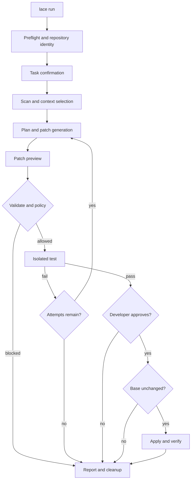

# CLI and Application Flow

All interfaces beyond the M1 commands are proposed until their milestone is implemented.

## Command Hierarchy

```text
lace --help | --version
lace doctor [--json]
lace validate PATCH --repo PATH [--json]       # M1
lace scan PATH [--json]                         # M2 proposed
lace run TASK --repo PATH [--config FILE]       # M3-M6 proposed
lace report RUN_ID [--json]                     # proposed
lace benchmark SUITE [--model NAME]              # M7 proposed
lace cleanup [--older-than DURATION]             # proposed
```

Exit codes: `0` success, `2` usage/configuration, `3` repository, `4` invalid patch, `5` policy blocked, `6` unavailable isolation/tool, `7` tests failed, `8` approval declined/state changed, `9` internal error, `130` cancellation.

## End-to-End Developer Flow

1. Resolve repository and config; display the repository root, base revision, model, isolation mode, and limits.
2. Accept a non-empty task; scan metadata and select explainable bounded context.
3. Request and display a structured plan. Model output remains a suggestion.
4. Generate, parse, preview, and policy-check the unified diff. Show targets, line counts, hard decisions, and risk factors.
5. Check applicability in a disposable copy. Never mutate the original during validation.
6. Run only configured pytest in restricted isolation. Stream bounded progress, not unbounded test output.
7. On failure, show a summary and either run a bounded repair attempt or stop according to configuration/user cancellation.
8. On success, show patch, test evidence, current-state preconditions, and request explicit approval.
9. Revalidate base state and patch immediately before controlled application. Write the final report and cleanup.



## Terminal Examples

```console
$ lace doctor
LACE 0.1.0
Python       ready   3.12.8
Git          ready   2.45.1
Ollama       optional unavailable (required from M5)
Isolation    optional unavailable (required before test execution)
Status       ready for Milestone 1 validation
```

```console
$ lace validate fix.patch --repo ./sample
Patch        allowed
Targets      src/sample/calculator.py
Changes      +1 -1
Policy       pass
Applicability pass (disposable copy)
Original     unchanged
```

Proposed full flow:

```console
$ lace run "Fix division by zero handling" --repo ./sample
Repository   sample @ 4a2c9f1 (clean)
Model        qwen2.5-coder:7b via local Ollama
Patch        1 file, +4 -1
Risk         18/100 low; no policy blocks
Tests        12 passed in 3.41s (restricted container)
Apply this verified patch to sample @ 4a2c9f1? [y/N]: y
Result       applied; report .lace/runs/01J.../report.json
```

## Preview and Results

Patch previews use standard diff colors only when supported, line-number gutters, and a color-free policy label. Risk is shown as score plus named factors, never as a safety guarantee. Test results show command template ID, environment image digest, counts, duration, exit status, truncation, and timeout.

## Errors, Cancellation, and Timeouts

- Validation errors identify safe line/field context but do not echo secrets.
- `Ctrl+C` stops the active model/test process, marks the run cancelled, attempts cleanup, and leaves the original unchanged.
- Model, Git, test, and approval waits have separate configurable timeouts.
- A failed cleanup is surfaced prominently with the retained path; it does not rewrite the primary result.
- Noninteractive mode never assumes approval. It requires an explicit future approval mechanism bound to patch and base hashes.

