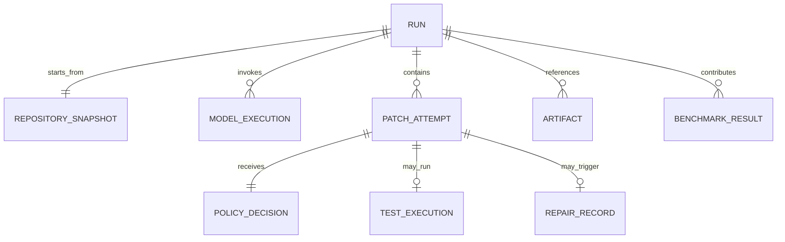

# Backend Architecture and Data Schema

## Package Organization

```text
src/lace/
  cli.py              # presentation and exit codes
  config.py           # validated settings
  logging.py          # structured/redacted logging
  contracts.py        # cross-module records
  patches/             # parser, path policy, statistics
  repository/          # discovery, inventory, integrity
  application/         # task/repair orchestration
  adapters/            # Git, Ollama, container, storage
```

M1 implements only CLI/config/logging and the patch-validation slice. Modules communicate with typed values, not mutable dictionaries. Domain code does not import Typer, HTTP clients, or concrete container APIs.

## Core Contracts

- `TaskRequest`: schema version, run ID, repository identity, task, config snapshot.
- `RepositorySnapshot`: canonical root, commit/tree/status hashes, inventory digest.
- `ModelExecution`: model/version/options, prompt/response hashes, timing, status.
- `PatchAttempt`: attempt number, parent, patch hash, targets/stats, decision, risk, applicability.
- `PolicyDecision`: `allowed`, blocking rule IDs, advisory findings.
- `TestExecution`: immutable command-template ID, image digest, limits, exit/counts/timing/output hashes.
- `RepairRecord`: failure summary hash, input attempt, output attempt, budget.
- `RunReport`: lifecycle status, approval/apply/rollback facts, artifact references.

## Configuration Schema

Precedence is CLI > `LACE_` environment > explicit config file > user config > defaults. Repository-controlled config cannot weaken global security policy without explicit operator authorization.

```json
{
  "schema_version": "1.0",
  "model": {"provider": "ollama", "name": "qwen2.5-coder:7b", "timeout_s": 120},
  "patch": {"max_bytes": 1048576, "max_files": 20, "max_changed_lines": 2000},
  "repair": {"max_attempts": 2},
  "execution": {
    "template": "python-pytest",
    "timeout_s": 120,
    "network": false,
    "memory_mb": 2048,
    "cpus": 2,
    "pids": 256
  },
  "retention": {"days": 30, "store_source": false, "store_prompts": false}
}
```

## Run Report Example

```json
{
  "schema_version": "1.0",
  "run_id": "01JEXAMPLE",
  "status": "verified_not_applied",
  "repository": {"base_commit": "abc123", "dirty_digest": "sha256:..."},
  "attempts": [{
    "number": 1,
    "patch_sha256": "...",
    "targets": ["src/example.py"],
    "policy": {"allowed": true, "blocks": [], "advisories": []},
    "risk": {"score": 8, "level": "low", "factors": []},
    "applicable": true,
    "test": {"status": "passed", "passed": 8, "failed": 0, "duration_ms": 931}
  }],
  "approval": {"required": true, "granted": false},
  "original_changed": false
}
```

## Logical Schema



## Storage, Logs, and Retention

Versioned JSON is authoritative for the MVP because it is inspectable and portable. SQLite becomes justified when querying many runs in M7; it is a rebuildable index, not the only evidence store. PostgreSQL is rejected. Artifacts live under a user-controlled data directory, not a target repository by default. Write atomically, use restrictive permissions where supported, store hashes for large/redacted artifacts, and delete expired workspaces before reports. Logs are JSON Lines for files and concise text for terminals. Cleanup is idempotent and records failures.

